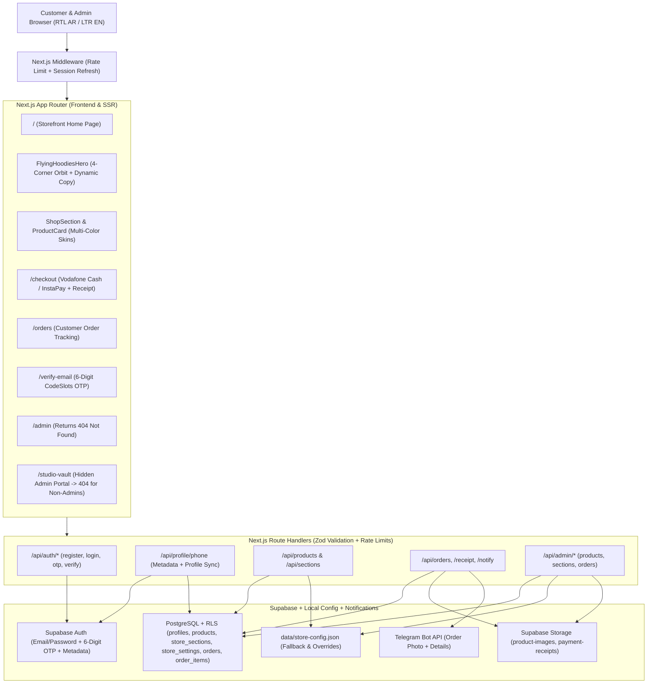
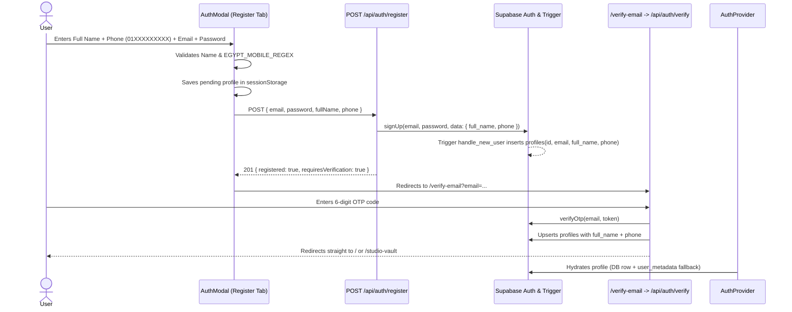
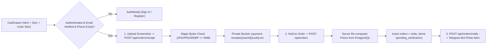
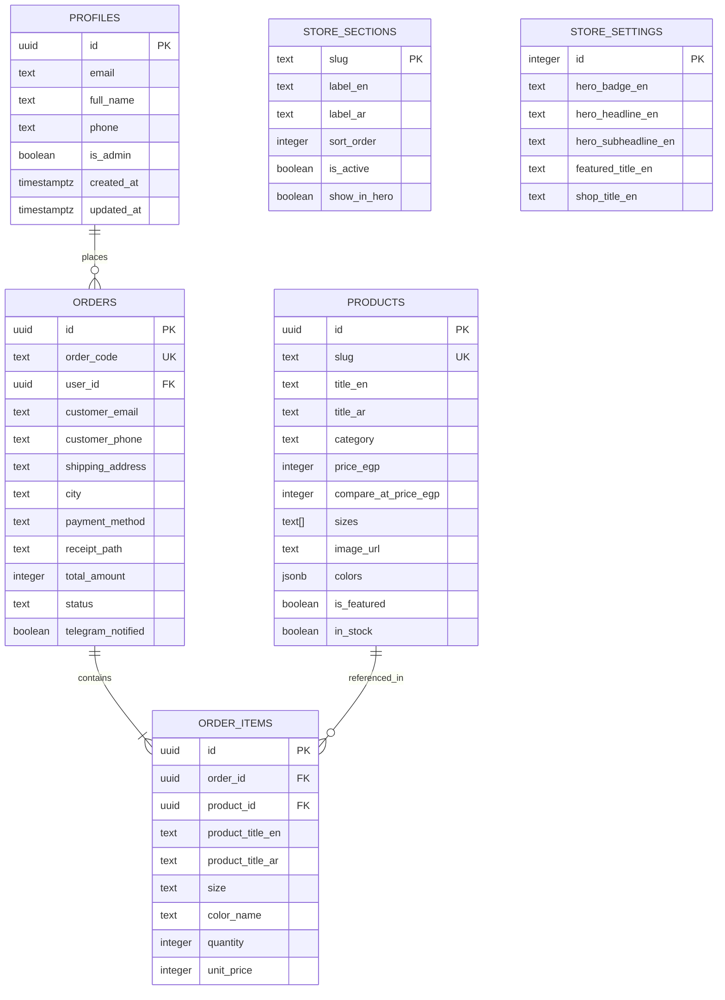

# ULTIMATE — Architecture & Technical Guide (`ultimate-wear.com`)

> Complete technical overview, architecture & database Mermaid diagrams, security layers, and operational tips.

---

## 1. Summary of Implemented Features & Fixes

### A. Smart Single-Step Registration (Name + Phone + Email Once)
- **Single-Form Sign-Up**: [src/components/layout/AuthModal.tsx](src/components/layout/AuthModal.tsx) collects **Full Name + Egyptian WhatsApp/Mobile (`01XXXXXXXXX`) + Email + Password** in one step.
- **No Re-Prompting**:
  - [src/app/api/auth/register/route.ts](src/app/api/auth/register/route.ts) validates `registerSchema` ([src/lib/security/validation.ts](src/lib/security/validation.ts)) and stores `full_name` and `phone` in Supabase Auth `user_metadata` immediately.
  - [supabase/schema.sql](supabase/schema.sql) updates `handle_new_user()` (`SECURITY DEFINER`) to copy `raw_user_meta_data->>'full_name'` and `raw_user_meta_data->>'phone'` into `public.profiles`.
  - [src/components/auth/VerifyEmailClient.tsx](src/components/auth/VerifyEmailClient.tsx) carries the pending profile metadata to [src/app/api/auth/verify/route.ts](src/app/api/auth/verify/route.ts), which saves the profile during OTP verification.
  - [src/components/providers/AuthProvider.tsx](src/components/providers/AuthProvider.tsx) merges DB profile rows with `user_metadata` fallback, silently backfills missing DB fields once in the background via [src/app/api/profile/phone/route.ts](src/app/api/profile/phone/route.ts), and never interrupts browsing with unsolicited profile prompts.
  - [src/lib/supabase/service.ts](src/lib/supabase/service.ts) provides `createOptionalServiceClient()` so server routes never crash when `SUPABASE_SERVICE_ROLE_KEY` is omitted from `.env.local`.

### B. Hidden Admin Portal (`/studio-vault`) & Concealed `/admin`
- Legacy `/admin` ([src/app/admin/layout.tsx](src/app/admin/layout.tsx), [src/app/admin/page.tsx](src/app/admin/page.tsx)) always invokes `notFound()` (**HTTP 404**).
- Active admin portal lives at `ADMIN_PORTAL_PATH` (`/studio-vault` in [src/lib/constants.ts](src/lib/constants.ts)).
- [src/app/studio-vault/layout.tsx](src/app/studio-vault/layout.tsx) calls `checkIsAdminUser()` and returns `notFound()` (**404**) for unauthenticated or non-admin users.
- All `/api/admin/*` endpoints use `requireAdminApi()` ([src/lib/security/admin-auth.ts](src/lib/security/admin-auth.ts)) and rate limiting in [src/lib/supabase/middleware.ts](src/lib/supabase/middleware.ts).

### C. Responsive 4-Corner Orbital Hero & Multi-Font Typography
- [src/components/storefront/FlyingHoodiesHero.tsx](src/components/storefront/FlyingHoodiesHero.tsx) displays all 4 featured hoodies around the central zero-gravity model on mobile, tablet, and desktop.
- [src/app/layout.tsx](src/app/layout.tsx) loads 7 Google Fonts (`Syne`, `Cairo`, `Cormorant Garamond`, `Amiri`, `Plus Jakarta Sans`, `IBM Plex Sans Arabic`, `JetBrains Mono`).

### D. Multi-Color Product Skins & Dynamic Sections CMS
- [src/components/admin/ProductEditorModal.tsx](src/components/admin/ProductEditorModal.tsx) manages per-hoodie `ProductColorVariant` skins (EN/AR names, hex color, custom image URL).
- [src/components/admin/SectionsManagerTab.tsx](src/components/admin/SectionsManagerTab.tsx) lets admins add/remove/reorder `StoreSection` entries and edit storefront EN/AR copy (`StoreSettings`), persisted via [src/lib/store-config.ts](src/lib/store-config.ts) to Supabase with local `data/store-config.json` fallback.

---

## 2. Complete System Diagrams

### System Architecture

### Single-Step Registration & OTP Verification Flow

### Checkout, Receipt Validation & Order Creation

### Database Schema ERD

